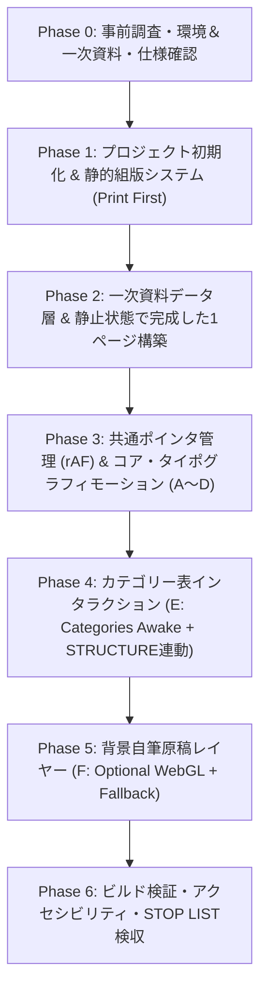

# Kant-inspired Typographic Website — 詳細実行計画書 (For Flash-tier Implementation Agent)

> [!IMPORTANT]
> **実装担当AIへの厳命（必読）**
> この計画書は、高速だが細部を省略・簡略化しやすいモデル（Gemini Flash系）が**一切の手抜き・デザイン崩れ・パフォーマンス劣化・偽データの捏造を起こさずに100%の品質で完走するため**の設計図です。
> - 「あとで調整する」「一旦ダミーテキストを置く」「簡易的なCSSカードで代用する」ことは**厳禁**です。
> - 必ず **Phase 0（事前調査・知見と環境の確認）** を最初に実行し、その結果を踏まえて Phase 1 以降のコードを1ファイルずつ順番通りに実装してください。

---

## 全体アーキテクチャ・フロー



---

## Phase 0: 事前調査（実装前に必ず最初に実行すること）

コードを1行も書く前に、以下の調査をツール（`view_file`, `run_command`, 必要に応じて `read_url_content`）で実行し、前提条件を確定させること。

### 0-1. Handoffドキュメント・サンプルコードの全件精読
以下のファイルをすべて読み込み、制約条件と既存リファレンス実装を把握する。
- [00_README.md](file:///c:/Users/user/Downloads/kant_typography_handoff/kant_typography_handoff/00_README.md)
- [01_DESIGN_PRINCIPLES.md](file:///c:/Users/user/Downloads/kant_typography_handoff/kant_typography_handoff/01_DESIGN_PRINCIPLES.md)
- [02_VISUAL_SYSTEM.md](file:///c:/Users/user/Downloads/kant_typography_handoff/kant_typography_handoff/02_VISUAL_SYSTEM.md)
- [03_INTERACTION_SPEC.md](file:///c:/Users/user/Downloads/kant_typography_handoff/kant_typography_handoff/03_INTERACTION_SPEC.md)
- [04_TECH_ARCHITECTURE.md](file:///c:/Users/user/Downloads/kant_typography_handoff/kant_typography_handoff/04_TECH_ARCHITECTURE.md)
- [05_DO_NOT_BUILD.md](file:///c:/Users/user/Downloads/kant_typography_handoff/kant_typography_handoff/05_DO_NOT_BUILD.md)
- [06_REFERENCES.md](file:///c:/Users/user/Downloads/kant_typography_handoff/kant_typography_handoff/06_REFERENCES.md)
- [07_PROMPT_FOR_CODING_AI.md](file:///c:/Users/user/Downloads/kant_typography_handoff/kant_typography_handoff/07_PROMPT_FOR_CODING_AI.md)
- [08_ACCEPTANCE_CHECKLIST.md](file:///c:/Users/user/Downloads/kant_typography_handoff/kant_typography_handoff/08_ACCEPTANCE_CHECKLIST.md)
- サンプル実装一式:
  - [TextFlip.tsx](file:///c:/Users/user/Downloads/kant_typography_handoff/kant_typography_handoff/examples/TextFlip.tsx)
  - [Typewriter.tsx](file:///c:/Users/user/Downloads/kant_typography_handoff/kant_typography_handoff/examples/Typewriter.tsx)
  - [ProximityLift.tsx](file:///c:/Users/user/Downloads/kant_typography_handoff/kant_typography_handoff/examples/ProximityLift.tsx)
  - [InkReveal.tsx](file:///c:/Users/user/Downloads/kant_typography_handoff/kant_typography_handoff/examples/InkReveal.tsx)
  - [text-effects.css](file:///c:/Users/user/Downloads/kant_typography_handoff/kant_typography_handoff/examples/text-effects.css)
  - [OptionalWebGLNotes.md](file:///c:/Users/user/Downloads/kant_typography_handoff/kant_typography_handoff/examples/OptionalWebGLNotes.md)

### 0-2. ライブラリ仕様・パッケージ調査
`npm view gsap version` 等、またはインストール後の `node_modules/gsap` 内の型定義（`node_modules/gsap/types/index.d.ts` および `SplitText.d.ts`）を確認し、以下を検証する。
1. **GSAP `SplitText` プラグインの有無とAPI確認**:
   - GSAP v3.13+ では `gsap/SplitText` が標準パッケージに同梱されている。
   - `SplitText.create(element, { type: "chars,words", aria: "auto" })` の型定義と挙動を確認する。
2. **Three.js のバンドルと型定義**:
   - `three` と `@types/three` のバージョン整合性を確認する。
   - 重い post-processing パッケージは導入せず、`THREE.ShaderMaterial` + `THREE.PlaneGeometry` 単体で軽量に実装する方針を固める。
3. **参考知見の確認（[06_REFERENCES.md](file:///c:/Users/user/Downloads/kant_typography_handoff/kant_typography_handoff/06_REFERENCES.md) 記載分）**:
   - ガウス関数による Proximity Lift の数式モデル（`influence = exp(-(dx²/sx² + dy²/sy²))`）
   - 1781年『Critik der reinen Vernunft』初版（A 80 / B 106）の `Tafel der Categorien` の正確なドイツ語表記・4分類×3項目構造・判断表（A 70 / B 95）との対応関係。

---

## コードの難所と実装トラップ回避策（Flashモデルが失敗しやすいポイント）

> [!CAUTION]
> 以下の5点は、素朴に書くと必ずバグ・レイアウト崩壊・フレームレート低下を引き起こす難所です。サンプルコード（`examples/`）をそのままコピペするだけでは不十分な点も含まれるため、以下の改良仕様を厳守してください。

### 難所1: `ProximityLift` における `getBoundingClientRect()` 連発による Layout Thrashing
- **問題**: [ProximityLift.tsx](file:///c:/Users/user/Downloads/kant_typography_handoff/kant_typography_handoff/examples/ProximityLift.tsx#L31-L46) のサンプルでは、`pointermove` イベントのたびに全文字要素に対して `ch.getBoundingClientRect()` を呼んでいる。文字数が30〜60文字になると1フレーム中に数十回のDOMレイアウト再計算が走り、60fpsを維持できない。また、[04_TECH_ARCHITECTURE.md](file:///c:/Users/user/Downloads/kant_typography_handoff/kant_typography_handoff/04_TECH_ARCHITECTURE.md#L47-L59) で「`pointermove`内でlayout read/writeを乱発しない」「`pointermove`の座標は一度だけ取り、各effectは共通stateを読む」と明記されている。
- **解決策**:
  1. グローバルな単一ポインタ管理モジュール（`src/utils/pointerStore.ts`）を作り、`window` への `pointermove` 登録をアプリ全体で**1箇所のみ**にする。
  2. 各文字の中心座標 `(cx, cy)` とサイズ `(width, height)` は、`SplitText` 完了時・`resize`（debounce 150ms）・`scroll` 時にのみ計算して配列にキャッシュする（またはセクションの基準矩形からの相対オフセット `(ox, oy)` としてキャッシュし、フレームごとに親要素の `getBoundingClientRect()` 1回だけ、あるいはスクロールオフセット加算だけで済ませる）。
  3. 文字ごとの `gsap.quickTo` 呼び出しは、`pointermove` イベント内ではなく `requestAnimationFrame` ループ（ポインタがセクション近傍にある時だけ稼働）で実行する。

### 難所2: React 19 `StrictMode` 下での `SplitText` 二重実行と非同期クリーンアップ漏れ
- **問題**: `document.fonts.ready.then(...)` は非同期であるため、React `StrictMode` の mount → unmount → remount が一瞬で走ると、unmount 後に1回目の `.then()` が発火して `SplitText.create()` が2重に適用され、DOM構造が破壊される。また `y` 軸に持ち上がった文字が親の行ボックスでクリップされたり、空白文字（スペース）が潰れたりする。
- **解決策**:
  ```ts
  useEffect(() => {
    let isCancelled = false;
    let split: SplitText | undefined;
    // ...
    document.fonts.ready.then(() => {
      if (isCancelled || !ref.current) return;
      split = SplitText.create(ref.current, {
        type: "words,chars",
        aria: "auto",
      });
      // ...
    });
    return () => {
      isCancelled = true;
      cleanupListeners?.();
      split?.revert();
    };
  }, []);
  ```
  - 必ず `type: "words,chars"` とし、単語途中の不自然な改行を防ぎつつ文字単位で動かす。

### 難所3: `TextFlip`（`REASON` ↔ `VERNUNFT`）の文字列長差による横幅ガタつきと3Dクリッピング
- **問題**: `REASON`（6文字）と `VERNUNFT`（8文字）では文字幅が異なる。さらにインライン要素の中で3D回転（`rotateX(-90deg)` + `translateZ(0.55em)`）を行うと、前後のテキストが押し出されたり、回転中に裏面が透けたり、ベースラインがずれる。
- **解決策**:
  - `.word-flip__stage` を `display: inline-grid; vertical-align: baseline; text-align: center;` とし、`.word-flip__front` と `.word-flip__back` の両方を `grid-area: 1 / 1;` に配置する。これにより、グリッドセルの横幅は常に長い方の単語（`VERNUNFT`）に固定され、ホバー前後で周囲のレイアウトが1pxも動かない。
  - 単語の下に細い組版アンダーライン（1px dashedまたはsolid `var(--rule)`）と小さな注釈番号（例: `[i]`）を添え、「触れると言語の層が反転する」アフォーダンスを品良く示す（派手なボタン装飾は禁止）。
  - トランジションは `transform 560ms cubic-bezier(0.2, 0.75, 0.2, 1)`、回転角は `-90deg` 厳守（360°回転やバウンスは絶対禁止）。

### 難所4: `Typewriter` の「ターミナル化」回避とレイアウトシフト防止
- **問題**: `setInterval` で1文字ずつ文字列を増やすだけの実装だと、複数行に折り返す際に文字が増えるたびに行の高さが変わってページ全体がガタつく（Layout Shift）。また、完了後にカーソルが点滅し続けるとターミナル風になってしまう（[03_INTERACTION_SPEC.md](file:///c:/Users/user/Downloads/kant_typography_handoff/kant_typography_handoff/03_INTERACTION_SPEC.md#L27-L42) 違反）。
- **解決策**:
  - コンテナを `position: relative; display: inline-block;` にし、不可視の全文（`visibility: hidden`）を背面に置いて最初から最終サイズ（幅・高さ）を確定させる。
  - その上に絶対配置（`position: absolute; inset: 0;`）で1文字ずつ組まれるテキストを重ねる。
  - 完了フラグ `isComplete` を持ち、全文字表示から `400ms` 後に縦罫カーソル（`::after`）の `opacity` を `0` にフェードアウトさせ、2度と再生しない。

### 難所5: `InkReveal` のタッチ端末・キーボード・Reduced Motion 対応と「スポットライト化」防止
- **問題**: CSSの `mask-image: radial-gradient(...)` だけだと、スマートフォン（タッチデバイス）やキーボード操作時に文章が薄いまま読めなくなる。また背景色を変えると「光るスポットライト」になり禁止事項に抵触する。
- **解決策**:
  - 背景色は一切変えず、文字色（`color: var(--ink)`）のマスク透過度と `filter: blur(1.4px)` の解除のみで「紙にインクが定着して鮮明になる」表現を作る。
  - `onFocus` / `onClick` または「全文を定着させる（Fix Ink / Read Full Text）」マイクロトグルボタン、および `(hover: none)` メディアクエリ時はスクロール進入またはタップで全体が鮮明に読める状態へ切り替わるようにする。

---

## Phase 1: プロジェクト初期化 & デザイントークン・組版システム設計

### 1-1. ディレクトリ・ファイル構成
ワークスペース `c:\Users\user\Documents\antigravity\amazing-bell` に以下の構成を作成する。

```text
c:\Users\user\Documents\antigravity\amazing-bell\
├── index.html
├── package.json
├── tsconfig.json
├── vite.config.ts
└── src/
    ├── main.tsx
    ├── App.tsx
    ├── data/
    │   └── kantArchiveData.ts       # 一次資料テキスト・カテゴリー表・書誌データ（偽引用防止のため一元管理）
    ├── utils/
    │   └── pointerStore.ts          # 単一pointermove + rAF購読ストア & reduced-motion判定
    ├── components/
    │   ├── TextFlip.tsx             # Interaction A: Semantic 3D Word Flip
    │   ├── Typewriter.tsx           # Interaction B: Lead-type Typewriter (1回再生・レイアウト固定)
    │   ├── ProximityLift.tsx        # Interaction C: Gaussian Pointer Proximity Lift (座標キャッシュ済)
    │   ├── InkReveal.tsx            # Interaction D: Ink Reveal (CSS Mask + Keyboard/Touch対応)
    │   ├── CategoryTable.tsx        # Interaction E: Tafel der Categorien (4列×3項目 + STRUCTURE連動)
    │   └── ManuscriptCanvas.tsx     # Interaction F: Optional WebGL Opus postumum depth layer
    └── styles/
        ├── tokens.css               # カラーパレット・フォント・グリッド変数・リセット
        ├── editorial-layout.css     # 1781年初版タイトルページ・12カラム組版・罫線・欄外注釈
        └── interactions.css         # A〜F のインタラクション用CSS・Reduced Motion対応
```

### 1-2. フォントとカラーパレット（[02_VISUAL_SYSTEM.md](file:///c:/Users/user/Downloads/kant_typography_handoff/kant_typography_handoff/02_VISUAL_SYSTEM.md) 準拠）
- `index.html` で Google Fonts から 18世紀活版印刷の気品を持つ **EB Garamond** / **Cormorant Garamond**（見出し・本文用セリフ）と、ニュートラルなグロテスク **Inter**（書誌メタデータ・欄外番号用）を読み込む。
- CSS変数（`src/styles/tokens.css`）:
  ```css
  :root {
    --paper: #F1EEE5;
    --paper-2: #E8E3D8;
    --ink: #181816;
    --ink-soft: #4E4A43;
    --rule: rgba(24, 24, 22, 0.20);
    --rule-strong: rgba(24, 24, 22, 0.48);
    --ghost: rgba(24, 24, 22, 0.08);
    --accent: #7A1F1A; /* 18世紀学術書の朱墨（Rubrication）。最小限の番号・記号にのみ使用 */

    --font-display: "Cormorant Garamond", "EB Garamond", Georgia, serif;
    --font-body: "EB Garamond", Georgia, serif;
    --font-meta: "Inter", -apple-system, BlinkMacSystemFont, sans-serif;
  }
  ```

---

## Phase 2: 一次資料データ層の確定と「静止画として完成した」組版構築

> [!IMPORTANT]
> [05_DO_NOT_BUILD.md](file:///c:/Users/user/Downloads/kant_typography_handoff/kant_typography_handoff/05_DO_NOT_BUILD.md#L93-L95) の「13. fake archive: 存在しない引用、偽のカント語録、意味のないドイツ語を生成しない」を厳守するため、`src/data/kantArchiveData.ts` に以下の**原典に基づく正確なテキストのみ**を定義する。

### 2-1. `src/data/kantArchiveData.ts` に格納する正確な一次資料データ
1. **書誌ヘッダー / 1781年初版タイトルページ情報**:
   - 原題: *Critik der reinen Vernunft*
   - 著者: *Immanuel Kant, Professor in Königsberg* (`1724 — 1804`)
   - 出版事項: *Riga, verlegt von Johann Friedrich Hartknoch, 1781.*
   - 対象箇所: *Transscendentale Elementarlehre, II. Theil, I. Abtheilung, I. Buch, I. Hauptstück, III. Abschnitt: Von dem reinen Verstandesbegriffe, oder den Categorien (A 76–83 / B 102–109).*
2. **Hero セクションのテキスト**:
   - 見出し組版:
     - 英語・ドイツ語対照の Semantic Flip ペア:
       - `REASON` ↔ `VERNUNFT`（主役）
       - `INTUITION` ↔ `ANSCHAUUNG`
       - `CONCEPT` ↔ `BEGRIFF`
   - 活字組版（Typewriter）用の原典引用（`A 11 / B 25`）:
     - 原文: *"Ich nenne alle Erkenntniß transscendental, die sich nicht so wohl mit Gegenständen, sondern mit unserer Erkenntnißart von Gegenständen, so fern diese a priori möglich seyn soll, überhaupt beschäftigt."*
     - 英訳: *"I entitle transcendental all knowledge which is occupied not so much with objects as with the mode of our knowledge of objects, in so far as this mode of knowledge is to be possible a priori."*
3. **カテゴリー表（`Tafel der Categorien`, `A 80 / B 106`）の4分類×3項目データ**:
   - **I. Of Quantity / Der Quantität**（Mathematical / *Mathematische*, B 110）
     - 対応する判断の量（`A 70 / B 95`）: *Universal / Particular / Singular*
     - 3項目:
       1. `Einheit` — *Unity*（Schema: Number / *Zahl*, A 142）
       2. `Vielheit` — *Plurality*（Magnitude / *Größe*）
       3. `Allheit` — *Totality*（Unity of Plurality / *Allheit oder Totalität*）
   - **II. Of Quality / Der Qualität**（Mathematical / *Mathematische*, B 110）
     - 対応する判断の質（`A 70 / B 95`）: *Affirmative / Negative / Infinite*
     - 3項目:
       1. `Realität` — *Reality*（Being in time / *Sein in der Zeit*, A 143）
       2. `Negation` — *Negation*（Non-being in time / *Nichtsein*）
       3. `Limitation` — *Limitation*（Degree of reality / *Grad der Realität*）
   - **III. Of Relation / Der Relation**（Dynamical / *Dynamische*, B 110）
     - 対応する判断の関係（`A 70 / B 95`）: *Categorical / Hypothetical / Disjunctive*
     - 3項目:
       1. `Inhärenz und Subsistenz` — *Inherence & Subsistence*（*substantia et accidens*）
       2. `Causalität und Dependenz` — *Causality & Dependence*（*Ursache und Wirkung* / Cause and Effect）
       3. `Gemeinschaft` — *Community*（*Wechselwirkung zwischen dem Handelnden und Leidenden* / Reciprocity）
   - **IV. Of Modality / Der Modalität**（Dynamical / *Dynamische*, B 110）
     - 対応する判断の様相（`A 70 / B 95`）: *Problematic / Assertoric / Apodictic*
     - 3項目:
       1. `Möglichkeit — Unmöglichkeit` — *Possibility — Impossibility*
       2. `Daseyn — Nichtseyn` — *Existence — Non-existence*
       3. `Nothwendigkeit — Zufälligkeit` — *Necessity — Contingency*
4. **Manifesto / Ink Reveal セクションの原典引用**:
   - `A 51 / B 75`:
     - *"Gedanken ohne Inhalt sind leer, Anschauungen ohne Begriffe sind blind. Daher ist es eben so nothwendig, seine Begriffe sinnlich zu machen (d. i. ihnen den Gegenstand in der Anschauung beyzufügen), als seine Anschauungen sich verständlich zu machen (d. i. sie unter Begriffe zu bringen)."*
     - *"Thoughts without content are empty, intuitions without concepts are blind. It is, therefore, just as necessary to make our concepts sensible, that is, to add the object to them in intuition, as to make our intuitions intelligible, that is, to bring them under concepts."*
   - `A 79 / B 105`:
     - *"Dieselbe Function, welche den verschiedenen Vorstellungen in einem Urtheile Einheit giebt, die giebt auch der bloßen Synthesis verschiedener Vorstellungen in einer Anschauung Einheit, welche, allgemein ausgedrückt, der reine Verstandesbegriff heißt."*
5. **Footer / Opus postumum 断片セクションの原典引用**:
   - 出典: *Opus postumum, Convolut VII (AA XXI: 116 / BBAW)*
   - *"Transscendentalphilosophie ist das System der synthetischen Erkenntniß a priori aus Begriffen."*

### 2-2. 1ページの4セクション構成と「1セクション1主役モーション」の原則
[01_DESIGN_PRINCIPLES.md](file:///c:/Users/user/Downloads/kant_typography_handoff/kant_typography_handoff/01_DESIGN_PRINCIPLES.md#L65-L76) に従い、1ページを以下の4セクションで構成し、**各セクションに主役の動きを配置する**。

| セクション | 紙面・組版モチーフ | 主役インタラクション |
| :--- | :--- | :--- |
| **§ I. Title Page (Hero)** | 1781年リガ初版タイトルページの中央揃え・広い余白・細い二重罫線・欄外頁番号 `A III / B VII` | **A. Semantic Word Flip** (`REASON` ↔ `VERNUNFT`) + **B. Typewriter** (1回再生の活字組版) |
| **§ II. Tafel der Categorien** | 12カラム（4 super-columns × 3 columns）構造表・ローマ数字 `I II III IV`・欄外注釈 `A 80 / B 106` | **C. Pointer Proximity Lift** (見出し) + **E. Categories Awake** (4列ホバー＆本文中の `STRUCTURE` 連動) |
| **§ III. Analytic of Concepts (Manifesto)** | 左右欄外に書誌番号を配した学術論文組版 (`A 51 / B 75`, `A 79 / B 105`) | **D. Ink Reveal** (カーソル近傍でインクが紙に定着して読める体験) |
| **§ IV. Opus postumum & Colophon (Footer)** | 1796–1803年遺稿ファクシミリ断片の組版と奥付・一次資料出典索引 | **F. Manuscript Depth** (背景自筆原稿の微細な1〜3px パララックス/WebGL奥行き + 初版コロフォン) |

---

## Phase 3: 共通ポインタ管理とインタラクション A〜D の実装仕様

### 3-1. `src/utils/pointerStore.ts`（共通ポインタ & 環境ストア）
- `window.addEventListener("pointermove", ...)` を1箇所だけで受け、`clientX`, `clientY` を更新する。
- `document.visibilityState === "hidden"` のときは全ての `requestAnimationFrame` 購読を一時停止する。
- `useReducedMotion()` フックおよび `(hover: hover) and (pointer: fine)` の判定を提供する。

### 3-2. `src/components/TextFlip.tsx`（Interaction A）
- Props: `front: string`, `back: string`, `noteIndex?: string`
- `<button type="button" className="word-flip" aria-label={`${front} (${back})`} aria-pressed={flipped}>`
- イベント: `onPointerEnter`, `onPointerLeave`, `onFocus`, `onBlur`, `onClick`（タッチ端末でのトグル対応）。
- 3D回転: `perspective: 900px`, `.word-flip__stage` に `transform: rotateX(-90deg)`。

### 3-3. `src/components/Typewriter.tsx`（Interaction B）
- Props: `text: string`, `speed?: number` (デフォルト `34ms`), `startDelay?: number` (デフォルト `250ms`)
- `prefers-reduced-motion: reduce` の場合は即座に全文を表示し、カーソルを表示しない。
- 通常時は `IntersectionObserver` で画面内に入った1度だけ再生し、完了後 `400ms` で `.typewriter--done` クラスを付与して縦罫カーソル（`1px` 幅）を静かに消す。

### 3-4. `src/components/ProximityLift.tsx`（Interaction C）
- `gsap.registerPlugin(SplitText)` を使用。
- `document.fonts.ready` 完了後に文字分割を実行。
- **座標キャッシュ機構**:
  - 文字要素配列 `chars` に対し、セクション基準またはビューポート基準の中心座標を計測する関数 `measureChars()` を用意し、初期化時・`window` の `resize`（debounce）・`scroll`（passive）時のみ更新する。
  - ポインタが要素の上（または上下マージン `80px` 以内）にある間だけ `pointerStore` からの通知でガウス関数を計算:
    - `sx = Math.max(charHeight * 1.8, 44)`
    - `sy = Math.max(charHeight * 1.15, 30)`
    - `influence = Math.exp(-((dx * dx) / (sx * sx) + (dy * dy) / (sy * sy)))`
    - `y = -charHeight * 0.28 * influence`（目安 `-0.24em`〜`-0.34em`）
    - `rotation = (-dx / sx) * 5.2 * influence`（目安 `±4°`〜`7°`）
  - `pointerleave` 時は全文字の `quickTo` を `y: 0, rotation: 0` に戻す。

### 3-5. `src/components/InkReveal.tsx`（Interaction D）
- 二重レイヤー構造:
  - `.ink-reveal__ghost`: `color: rgba(24, 24, 22, 0.14); filter: blur(1.35px);`
  - `.ink-reveal__ink`: `position: absolute; inset: 0; color: var(--ink); mask-image: radial-gradient(circle 145px at var(--mx) var(--my), #000 0%, rgba(0,0,0,0.85) 38%, transparent 76%);`
- ポインタ移動時は `requestAnimationFrame` 経由で `--mx`, `--my` を滑らかに補間（lerp 係数 `0.22`）して更新することで、紙にインクがじわっと定着する質感を出す。
- キーボードの `focus-within` 時、タッチ端末（`hover: none`）、またはセクション右上の控えめな「`[ Fix Ink / 全文定着 ]`」ボタン押下時は `.is-fully-inked` クラスを付与し、マスクを解除して全文をくっきり読める状態にする（[04_TECH_ARCHITECTURE.md](file:///c:/Users/user/Downloads/kant_typography_handoff/kant_typography_handoff/04_TECH_ARCHITECTURE.md#L82) のアクセシビリティ要件を満たす）。

---

## Phase 4: カテゴリー表インタラクション（Interaction E: Categories Awake）

### 4-1. `src/components/CategoryTable.tsx`
- デスクトップでは **12カラムグリッド（4 super-columns × 各3カラム幅）**、モバイル（`max-width: 900px`）では **4カラム縦積み** にレスポンシブ変換する。
- セクション導入文の中にインタラクティブ語句 **`STRUCTURE`**（ボタンまたはフォーカス可能要素）を配置し、これに hover / focus した際は**全4列の罫線と構造番号が一斉に浮かび上がる**（[01_DESIGN_PRINCIPLES.md](file:///c:/Users/user/Downloads/kant_typography_handoff/kant_typography_handoff/01_DESIGN_PRINCIPLES.md#L27-L28): `STRUCTURE → hover → カテゴリー表の罫線が浮く`）。
- 4列（`I. Quantität`, `II. Qualität`, `III. Relation`, `IV. Modalität`）それぞれに hover / focus / tap したとき:
  - 該当列の上下・左右の罫線が `var(--rule)` から `var(--ink)` 近くへ濃くなる。
  - 列内の3項目（`01`, `02`, `03`）が `-3px`〜`-4px` 静かに持ち上がる（スタガー `40ms`）。
  - 初期状態では控えめな濃度の欄外注釈（対応する判断表 `A 70 / B 95` と図式論 `A 142–145` のマイクロテキスト）が鮮明に立ち上がる。
  - **他列は消さない**（比較可能な状態を維持する）。

---

## Phase 5: 背景自筆原稿レイヤー（Interaction F: Optional WebGL + Graceful Fallback）

### 5-1. `src/components/ManuscriptCanvas.tsx`
- **重要方針**: 外部画像の著作権問題やリンク切れを防ぎつつ、[06_REFERENCES.md](file:///c:/Users/user/Downloads/kant_typography_handoff/kant_typography_handoff/06_REFERENCES.md#L125-L135) の *Opus postumum* の筆跡・余白書き込み・抹消線・幾何学図形のモチーフを忠実に再現するため、オフスクリーン `<canvas>` で高精細な **18世紀手稿ファクシミリ・テクスチャ** をプロシージャル生成し、それを `THREE.CanvasTexture` として WebGL の `PlaneGeometry` に貼る。
- **WebGL シェーダー仕様**:
  - `opacity` は `0.04`〜`0.085` の極薄設定（「読ませない」「思考の痕跡として背景にごく薄く使う」）。
  - ポインタ位置に応じて **1〜3px のパララックス**、**0.3°〜0.6° の微細な tilt**、およびごく弱い紙面 displacement を与える。
  - **画面全面に敷かない**: セクションIの一部余白またはセクションIV（Opus postumum 断片領域）にクロップして配置する。
- **パフォーマンスとフォールバック**:
  - `renderer.setPixelRatio(Math.min(window.devicePixelRatio, 1.75))`
  - `IntersectionObserver` で画面外にある時はレンダリングループを完全停止する。
  - `document.visibilityState === "hidden"` 時も停止する。
  - WebGL初期化失敗時や `prefers-reduced-motion: reduce` 時は WebGL を起動せず、静的なSVG/Canvasファクシミリ断片を表示する（WebGLを切ってもサイトの価値と情報が100%残る設計）。
  - クリーンアップ時に `geometry.dispose()`, `material.dispose()`, `texture.dispose()`, `renderer.dispose()` を確実に呼ぶ。

---

## Phase 6: 検収・ビルド・アクセシビリティ検証（Acceptance Checklist）

実装完了後、以下のコマンドとチェックリストをすべて確認すること。

1. **型チェックと本番ビルド検証**:
   - `npm run build`（`tsc -b && vite build`）がエラー・警告ゼロで通ること。
2. **開発サーバー起動と動作確認**:
   - `npm run dev` で起動し、エラーログやコンソールエラーがないことを確認する。
3. **[05_DO_NOT_BUILD.md](file:///c:/Users/user/Downloads/kant_typography_handoff/kant_typography_handoff/05_DO_NOT_BUILD.md) 絶対禁止リストのゼロ確認**:
   - ネオン、サイバーパンク、グリッチ、VHS、CRT、ターミナル緑、Win95、ピクセルフォント、青紫グラデーション、角丸SaaSカード、カントの肖像画、スクロールジャック、常時マーキー、偽のカント引用が**1つも含まれていないこと**。
4. **[08_ACCEPTANCE_CHECKLIST.md](file:///c:/Users/user/Downloads/kant_typography_handoff/kant_typography_handoff/08_ACCEPTANCE_CHECKLIST.md) 全項目クリア**:
   - スクリーンショット（静止状態）だけでも18世紀の思想書・現代の研究誌として成立するか。
   - `REASON` ↔ `VERNUNFT` の3D反転と戻りが滑らかか。
   - Typewriterがターミナル化せず、1回だけ組版されて止まるか。
   - Proximity Liftが1文字だけでなく周囲の文字も丘のように滑らかに持ち上がるか。
   - Ink Revealが光らず、紙にインクが定着するように見えるか。
   - キーボードの `Tab` フォーカス移動だけで全インタラクション（Flip、Category列、Ink Reveal）の意味が欠落せず体験できるか。
   - 全本文テキストがマウスでドラッグ選択・コピー可能か。
